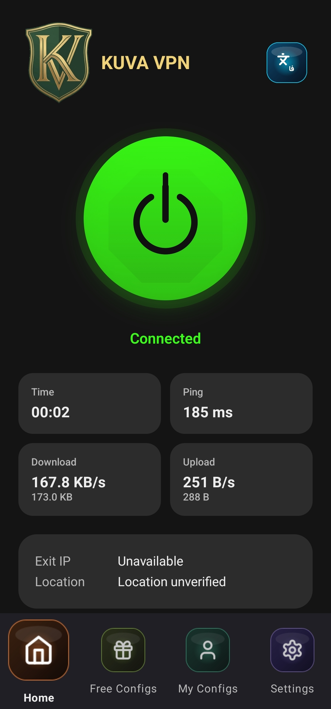
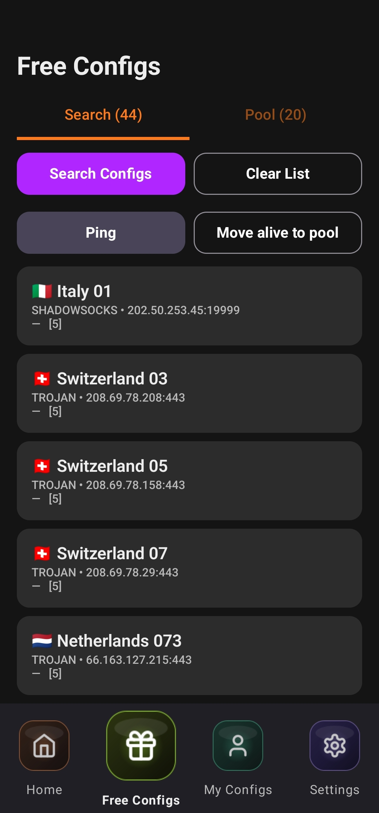
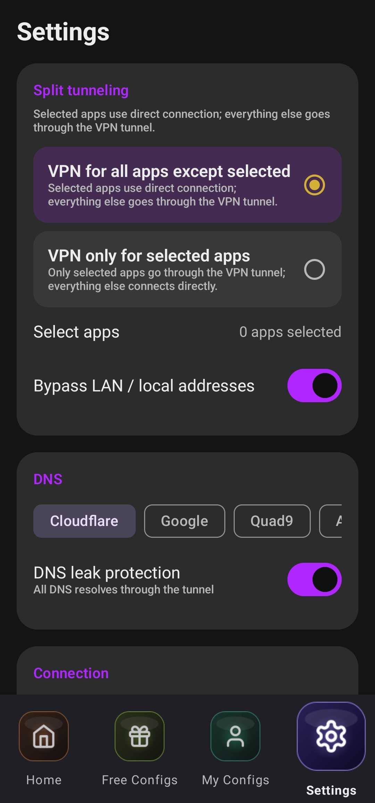

# KUVAVpn

[English](README.md) | [فارسی](README.fa.md)

<p align="center">
  
</p>

<p align="center">
  &nbsp;&nbsp;
  &nbsp;&nbsp;
  
</p>

کلاینت وی‌پی‌ان اندروید با هسته‌ی **Xray-core** — پشتیبانی از VLESS / VMess /
Trojan / Shadowsocks / SOCKS / HTTP و ترنسپورت‌های REALITY، TLS، WebSocket،
gRPC، HTTP/2، HTTPUpgrade و XHTTP. ساخته‌شده با Kotlin و Jetpack Compose
(Material 3) بر پایه‌ی معماری Clean Architecture و MVVM.

## قابلیت‌ها

| بخش | توضیح |
|---|---|
| تانل واقعی | `VpnService` (TUN) + hev-socks5-tunnel + هسته‌ی Xray |
| پارس کانفیگ | لینک‌های اشتراک vless/vmess/trojan/ss/socks/http و JSON خام Xray — مقاوم در برابر ورودی خراب |
| ساخت کانفیگ | تولید کامل JSON هسته (inbound، DNS، routing، REALITY/TLS) |
| کانفیگ رایگان | جمع‌آوری از منابع عمومی (GitHub، تلگرام)، فقط افزودن، بدون حذف کانفیگ‌های شما، تشخیص تکراری با اثر انگشت محتوا |
| تست پینگ واقعی | TCP handshake + رفت‌وبرگشت کامل از داخل تانل |
| تست سرعت واقعی | دانلود/آپلود HTTP محدودشده از داخل تانل |
| آمار زنده | شمارش واقعی بایت‌ها از تانل، سرعت لحظه‌ای و مجموع با به‌روزرسانی ثانیه‌ای |
| تأیید IP خروجی | استعلام geoip **از داخل تانل** بعد از اتصال |
| کانفیگ‌های من + اشتراک | ورود با لینک/کلیپ‌بورد/QR/فایل/دستی، به‌روزرسانی اشتراک با اطلاعات انقضا |
| Split tunneling | استثنا یا محدودکردن اپ‌ها به‌صورت تکی |
| دور زدن سایت‌های ایرانی | دامنه‌ها و IPهای ایران مستقیم وصل می‌شوند — بانک و سامانه‌های دولتی با VPN روشن کار می‌کنند |
| دیتابیس‌های Geo | نسخه‌ی باندل‌شده از Loyalsoldier + به‌روزرسانی درون‌اپی از گیت‌هاب با بررسی sha256 |
| انتخاب هوشمند | وزن‌دهی بر اساس پینگ اندازه‌گیری‌شده (۴۵٪)، سرعت دانلود (۳۵٪)، آپلود (۱۰٪)، تازگی (۱۰٪) |
| امنیت | رمزنگاری AES-256-GCM با Android Keystore برای UUIDها و آدرس اشتراک‌ها، HTTPS همه‌جا، بدون ارسال داده به شخص ثالث |
| امکانات دیگر | اتصال خودکار بعد از بوت، کاشی Quick Settings، اعلان با سرعت زنده، تاریخچه‌ی اتصال،favorites، رابط انگلیسی/فارسی با RTL |

## ساختار ریپو

```
kuva-vpn/
├── app/                        # ماژول اصلی اندروید
│   └── src/main/java/com/kuva/vpn/
│       ├── core/               # engine، config، tunnel، stats، discovery، diagnostics، service
│       ├── data/               # Room، DataStore، رمزنگاری، ریپازیتوری‌ها
│       ├── domain/             # مدل‌ها، اینترفیس‌ها، یوزکیس‌ها
│       ├── ui/                 # صفحه‌های Compose و تم و ناوبری
│       └── di/                 # ماژول‌های Hilt
├── core-engine/
│   ├── libv2ray/               # سورس AndroidLibXrayLite — ساخت AAR از این‌جا
│   └── assets/                 # geoip.dat / geosite.dat همراه اپ
├── art/brand/                  # فایل‌های برند
├── art/screenshots/            # اسکرین‌شات‌های اپ برای README
└── docs/                       # BUILDING، SECURITY، PRIVACY، LICENSES
```

## شروع سریع

**فقط می‌خواهید اپ را نصب کنید؟** آخرین نسخه را از
[**Releases**](https://github.com/kuva-project/kuva-vpn/releases/latest)
دانلود کنید:

| فایل | مناسب برای |
|---|---|
| `KUVAVpn-v1.0.3-arm64-v8a.apk` | همه‌ی گوشی‌های مدرن (پیشنهادی) |
| `KUVAVpn-v1.0.3-armeabi-v7a.apk` | گوشی‌های قدیمی ۳۲ بیتی |
| `KUVAVpn-v1.0.3-x86.apk` / `KUVAVpn-v1.0.3-x86_64.apk` | تبلت‌های اینتل / شبیه‌سازها |
| `KUVAVpn-v1.0.3-universal.apk` | هر دستگاهی (حجم بیشتر) |

حداقل اندروید: **۸.۰ (API 26)**.

> **⚠️ توجه Google Play Protect:** چون APK از گیت‌هاب دانلود می‌شود (خارج از
> Google Play)، Play Protect موقع نصب ممکن است پیام «Harmful app blocked»
> نشان دهد. روی **Install anyway** بزنید — فایل‌های ریلیز مستقیماً در همین
> ریپو ساخته و منتشر می‌شوند و اسکن
> [VirusTotal](https://www.virustotal.com/) آن‌ها تمیز است (۰ از ۶۸ موتور).
> برای رفع این هشدار اشتباه، درخواست بازبینی به گوگل ثبت شده است.

### به‌روزرسانی

اپ نسخه‌های جدیدتر را در GitHub Releases چک می‌کند: **Settings → About KUVA VPN
→ Check for updates**. اگر نسخه‌ی جدید پیدا شد، **Download & install** را بزنید
و دیالوگ نصب سیستم را تأیید کنید — کانفیگ‌ها و تنظیمات حفظ می‌شوند. فقط بار
اول: اگر پیام «Install permission needed» دیدید، رویش بزنید و اجازه‌ی
**Install unknown apps** را برای KUVAVpn بدهید و دوباره تلاش کنید.

**بیلد از سورس:** راهنمای کامل ابزارها و بیلد: **docs/BUILDING.md**
(تنظیم یک‌باره‌ی ابزارها + دو دستور بیلد).

```powershell
.\gradlew.bat assembleDebug     # debug build
.\gradlew.bat assembleRelease   # signed release — requires your own keystore
```

دستور اول نسخه‌ی تست و دستور دوم نسخه‌ی امضاشده‌ی ریلیز را می‌سازد
(برای ریلیز به keystore شخصی خودت نیاز داری — جزئیات در **docs/BUILDING.md**).

## حریم خصوصی

بدون اکانت، بدون آنالیتیکس، بدون تلمتری — توسعه‌دهنده هیچ بک‌اندی ندارد و
هیچ داده‌ای دریافت نمی‌کند. جزئیات کامل: **docs/PRIVACY.md**.

## تضمین‌های سخت (معیارهای پذیرش)

1. **هیچ قابلیت ساختگی** — هر مقدار پینگ/سرعت/آمار از اندازه‌گیری واقعی
   می‌آید؛ مسیر شبیه‌سازی‌شده در کد وجود ندارد.
2. **جداسازی کانفیگ رایگان و شخصی** — ستون `scope` و کوئری‌های محدود‌شده؛
   به‌روزرسانی اشتراک فقط ردیف‌های همان اشتراک را می‌بیند و کانفیگ‌های دستی
   شخصی هرگز خودکار حذف نمی‌شوند.
3. **جمع‌آوری فقط-افزودنی** — ایمپورت هرگز چیزی را بازنویسی یا حذف نمی‌کند؛
   تکراری‌ها با اثر انگشت محتوا رد می‌شوند.
4. **حذف مرده‌ها تأییدشده** — فقط کانفیگ‌هایی حذف می‌شوند که در بازبینی
   دوباره شکست بخورند؛ سالم‌ها دوباره فعال علامت می‌خورند.
5. **پارس مقاوم** — لینک یا بدنه‌ی خراب `null` برمی‌گرداند، هرگز کرش نمی‌کند.
6. **بدون اسرار متنی** — UUIDها، رمزها و آدرس اشتراک‌ها با کلید Android
   Keystore رمزنگاری می‌شوند.

## مجوز

فایل LICENSE را ببینید؛ لیست مجوز اجزا: **docs/LICENSES.md**.
